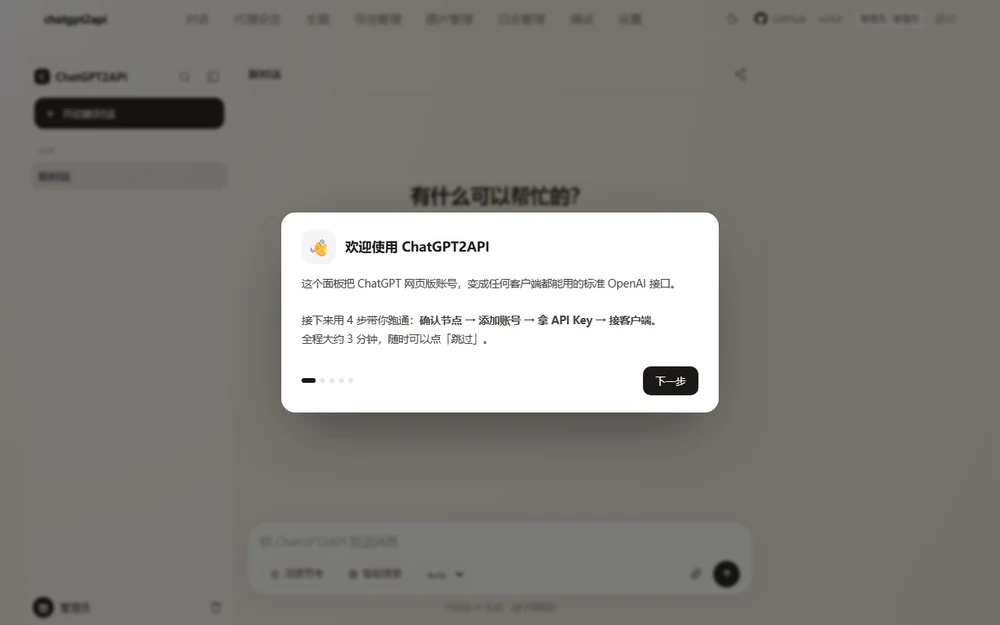
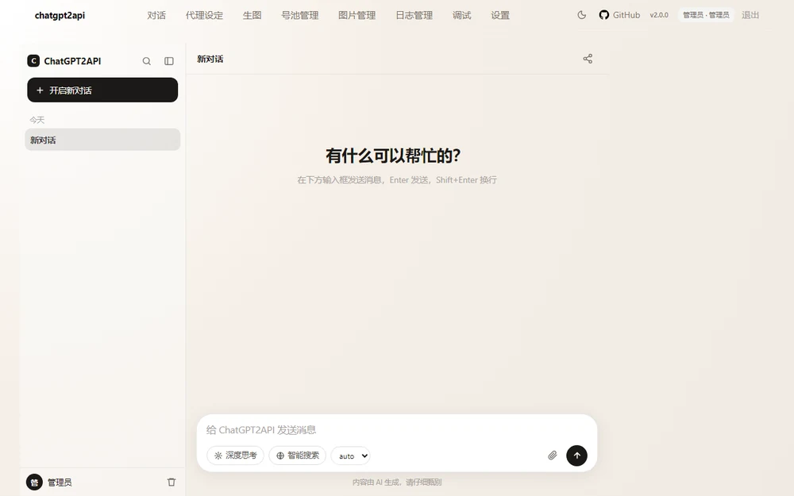
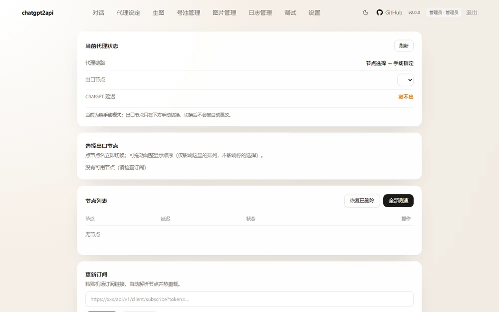
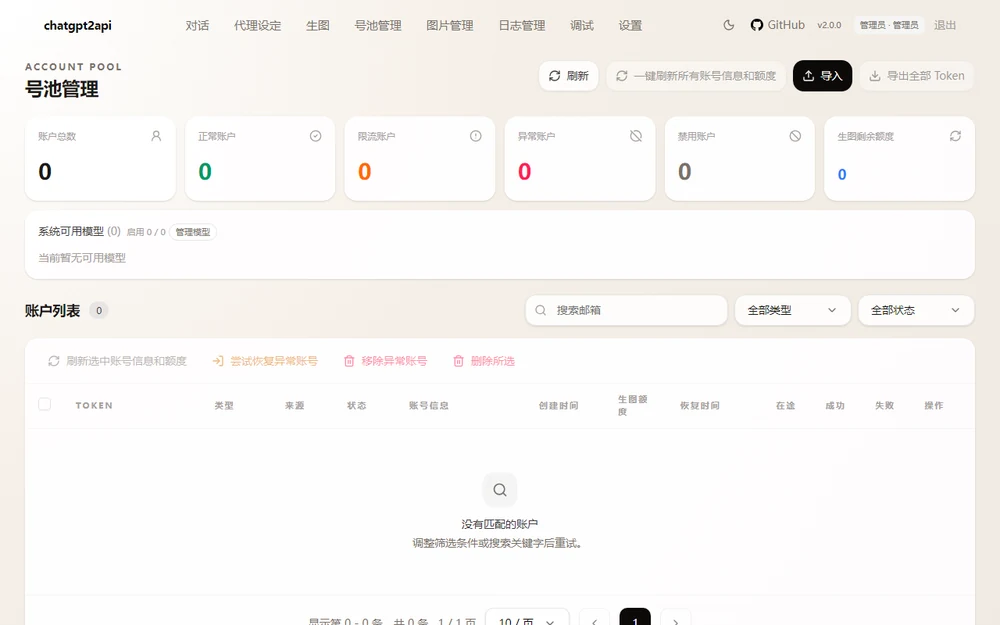
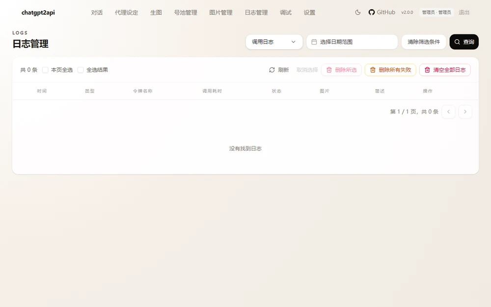
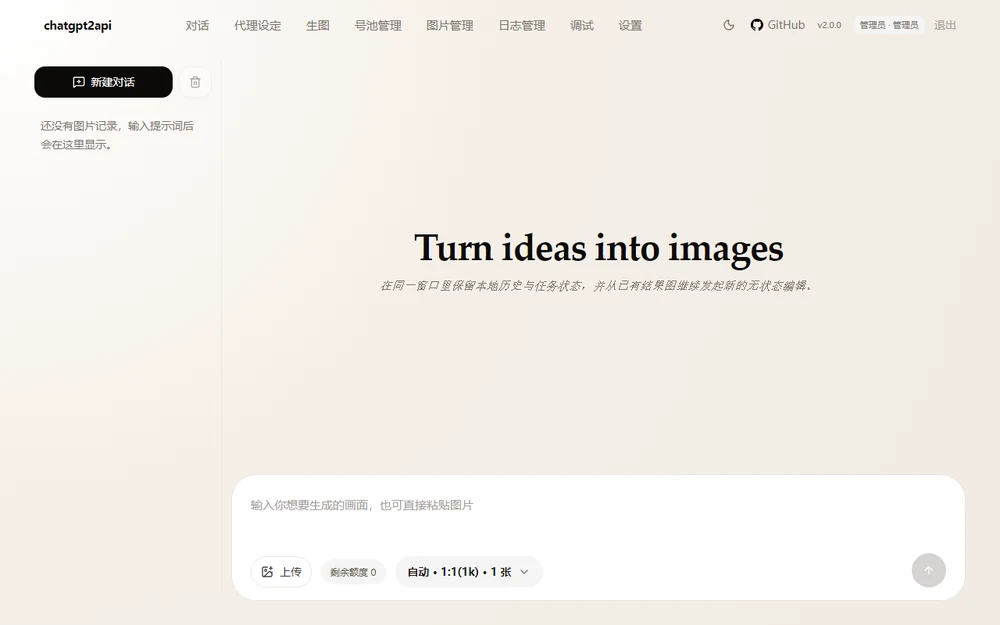

<div align="center">

# ChatGPT2API All-in-One

**把 ChatGPT 网页版账号，变成任何客户端都能用的标准 OpenAI 接口**

一个容器 = 代理内核 + 账号池 + OpenAI 兼容网关 + 可视化控制台 + 内置浏览器

[](LICENSE)
[](docs/DEPLOY-DOCKER.md)
[](VERSION)
[](docs/)

[功能特性](#-功能特性) · [界面预览](#-界面预览) · [快速开始](#-快速开始) · [部署指南](#-部署指南) · [API 用法](#-api-用法) · [常见问题](docs/FAQ.md)

</div>

| 你得到什么 | 具体说明 |
|---|---|
| **一个 OpenAI 兼容接口** | `http://你的地址:3100/v1`，任何支持 OpenAI 协议的客户端直接填地址就能用 |
| **一个可视化控制台** | 对话测试、代理节点、账号池、生图、日志、设置，全程点鼠标不用改配置 |
| **一个容器搞定全部** | 代理内核 + 账号池 + 网关 + 内置浏览器打包在一起，`docker compose up -d` 即用 |

> **适合**：想在 Cherry Studio / ChatBox / Cline / Dify 里用自己的 ChatGPT 账号；
> 想给多台设备共用一个账号池；想搭个私有 AI 网关。

---

## 📖 这是什么

ChatGPT 网页版很好用，但它没有标准 API，所以在 Cherry Studio、ChatBox、Cline、Dify
这类工具里用不了。

这个项目做的事：**在你自己的机器上跑一个容器，把网页版账号"翻译"成 OpenAI 标准接口**，
顺便把部署过程中最烦的几件事都解决了：

- 国内网络打不开 ChatGPT → 容器内自带代理内核，节点手动选，选完就锁定
- 加账号要复制一大串回调链接 → 容器内跑一个浏览器，登录完**自动**加进号池
- 一个号额度不够 → 支持多账号池、自动轮换、额度与限流状态可见
- 折腾配置太麻烦 → 图形化面板，全程点鼠标，不用改配置文件

### 适合谁

- 想在本地 AI 客户端里用自己的 ChatGPT 账号
- 有多台设备 / 多个工具，想共用一个账号池
- 想给自己或小团队搭一个"私有 AI 网关"
- 想把 ChatGPT 接到自己的自动化流程里

---

## ✨ 功能特性

<table>
<tr><td width="50%" valign="top">

**🗣 对话**
- 内置对话页，对标网页版体验
- 流式输出、Markdown 渲染
- 会话侧栏、搜索、重命名、删除
- 深度思考折叠、复制、重试、赞踩
- 多模型切换（下拉即时生效）

**🔐 账号池**
- OAuth 登录，**登录完自动入库**
- 也支持 Token / Session JSON / 账号文件导入
- 额度与限流状态一目了然
- 号池轮询，一个号用完自动换下一个

</td><td width="50%" valign="top">

**🌐 代理**
- 内置 mihomo 内核
- 订阅一键导入、节点测速、删除管理
- **纯手动选节点**，选完锁定不漂移
- 出口 IP / 地区实时显示

**🎨 生图**
- `gpt-image-2` 文生图 / 图生图
- 返回的图片 URL 自动改写为可访问地址
- 图片管理与清理

</td></tr>
<tr><td valign="top">

**🔌 接口兼容**
- `/v1/chat/completions`（流式 + 工具调用）
- `/v1/models`、`/v1/images/generations`
- `/v1/messages`（Anthropic 格式）
- Bearer / x-api-key / 查询参数三种认证

</td><td valign="top">

**🛠 工程细节**
- 单端口 3100：页面和 API 同一个地址
- 前端补丁机制，无需改上游源码
- 流式输出净化，不泄漏内部代码
- 62 项自检脚本，一键体检

</td></tr>
</table>

---

## 🖼 界面预览

<table>
<tr>
<td width="50%"><b>首次使用引导</b><br><sub>自动弹出，5 步跑通</sub><br>
</td>
<td width="50%"><b>对话页</b><br><sub>流式输出、Markdown、会话管理</sub><br>
</td>
</tr>
<tr>
<td><b>代理设定</b><br><sub>节点测速、手动切换、出口可见</sub><br>
</td>
<td><b>号池管理</b><br><sub>账号、额度、模型开关</sub><br>
</td>
</tr>
<tr>
<td><b>日志管理</b><br><sub>调用记录、一键清空</sub><br>
</td>
<td><b>生图</b><br><sub>gpt-image-2 文生图/图生图</sub><br>
</td>
</tr>
</table>

> 截图取自**空白环境**（无账号、无订阅），仅演示界面布局。

---

## 🚀 快速开始

### 前置条件

- 已安装 Docker（Windows / macOS 用 [Docker Desktop](https://www.docker.com/products/docker-desktop/)）
- 一个 ChatGPT 账号
- 一个可用的代理订阅（机场链接）

### 三步启动

```bash
# 1. 下载
git clone https://github.com/luo-sri/chatgpt2api.git
cd chatgpt2api

# 2. 配置密钥（改成你自己的）
cp .env.example .env

# 3. 启动
docker compose up -d
```

等约 1-2 分钟（首次要拉基础镜像 + 启动代理内核）。

### 打开控制台

浏览器访问 **<http://127.0.0.1:3100>**

用 `.env` 里的 `CHATGPT2API_AUTH_KEY` 登录。

### 第一次使用（面板里有引导，也可以照这个走）

| 步骤 | 在哪做 | 做什么 |
|---|---|---|
| **1. 配节点** | 左侧「代理设定」 | 粘贴机场订阅链接 → 更新订阅 → 选一个美国/日本节点 |
| **2. 加账号** | 左侧「号池管理」→ 导入 → OAuth 登录 | 点「打开授权页面」，在弹出的内置浏览器里登录 ChatGPT |
| **3. 拿 Key** | 左侧「设置」 | 复制 `sk-` 开头的 API Key |
| **4. 接客户端** | 你的 AI 客户端 | Base URL 填 `http://127.0.0.1:3100/v1`，Key 填上一步复制的 |

> 加账号**不需要复制任何链接**。登录成功后，容器内的浏览器会被自动读取，
> 账号直接进号池。

### 验证是否成功

```bash
curl http://127.0.0.1:3100/health
# {"status": "ok"}

# 完整自检（62 项）
python selfcheck.py
```

---

## 📦 部署指南

不同环境有详细步骤，点对应链接：

| 环境 | 文档 | 说明 |
|---|---|---|
| **Windows** | [DEPLOY-WINDOWS.md](docs/DEPLOY-WINDOWS.md) | Docker Desktop，含开机自启、端口冲突处理 |
| **Docker / 通用** | [DEPLOY-DOCKER.md](docs/DEPLOY-DOCKER.md) | compose 与 docker run 两种方式、参数详解 |
| **飞牛 NAS / 群晖** | [DEPLOY-NAS.md](docs/DEPLOY-NAS.md) | 图形界面 + SSH 两种装法、离线导入镜像 |
| **Linux 服务器** | [DEPLOY-LINUX.md](docs/DEPLOY-LINUX.md) | 含 systemd 守护、Nginx 反代、HTTPS |

### 端口说明

只需要关心三个端口：

| 端口 | 用途 | 必要性 |
|---|---|---|
| **3100** | 页面 + API + 生图（**唯一主端口**） | 必须 |
| 8888 | 授权转发代理（备用方案） | 可选 |
| 6080 | 内置浏览器画面（加账号用） | 加账号时需要 |

---

## 🔌 API 用法

### 基本信息

```
Base URL : http://127.0.0.1:3100/v1
API Key  : 设置页里 sk- 开头的那串
Model    : auto / gpt-6 / gpt-5-6 / gpt-image-2 ...
```

### Python

```python
from openai import OpenAI

client = OpenAI(base_url="http://127.0.0.1:3100/v1", api_key="sk-你的key")

# 普通对话
r = client.chat.completions.create(
    model="auto",
    messages=[{"role": "user", "content": "你好"}],
)
print(r.choices[0].message.content)

# 流式
for chunk in client.chat.completions.create(
    model="auto",
    messages=[{"role": "user", "content": "讲个笑话"}],
    stream=True,
):
    if chunk.choices[0].delta.content:
        print(chunk.choices[0].delta.content, end="")

# 生图
img = client.images.generate(
    model="gpt-image-2",
    prompt="一只橘猫坐在草地上",
    size="1024x1024",
)
print(img.data[0].url)
```

### curl

```bash
curl http://127.0.0.1:3100/v1/chat/completions \
  -H "Content-Type: application/json" \
  -H "Authorization: Bearer sk-你的key" \
  -d '{
    "model": "auto",
    "messages": [{"role": "user", "content": "你好"}],
    "stream": false
  }'
```

完整接口文档见 [docs/API.md](docs/API.md)。

### 常见客户端填写方式

| 客户端 | Base URL | Key |
|---|---|---|
| Cherry Studio | `http://127.0.0.1:3100/v1` | `sk-...` |
| ChatBox | `http://127.0.0.1:3100/v1` | `sk-...` |
| Cline / Continue | `http://127.0.0.1:3100/v1` | `sk-...` |
| Dify / FastGPT | 选「OpenAI 兼容」，填上面的地址 | `sk-...` |

> 其他设备（手机、另一台电脑）访问，把 `127.0.0.1` 换成宿主机的局域网 IP，
> 例如 `http://192.168.1.100:3100/v1`。

---

## 🏗 架构

```
                    ┌─────────────────────────────────────────┐
   你的 AI 客户端 ──▶│  3100  网关（OpenAI 兼容 + 页面路由）    │
                    └───────────────┬─────────────────────────┘
                                    │
                    ┌───────────────┴──────────────┬──────────────┐
                    ▼                              ▼              ▼
          ┌──────────────────┐          ┌──────────────────┐  ┌─────────┐
          │ 3001 面板 + 账号池│          │ 7890 mihomo 代理 │  │6080 内置│
          │      ChatGPT     │◀────────▶│  → OpenAI 上游   │  │ 浏览器  │
          └──────────────────┘          └──────────────────┘  └─────────┘
```

详细原理（进程拓扑、请求链路、前端补丁机制、二次开发）见
[docs/ARCHITECTURE.md](docs/ARCHITECTURE.md)。

---

## ⚙️ 常用命令

```bash
docker compose up -d            # 启动
docker compose restart          # 重启
docker compose logs -f          # 看日志
docker compose down             # 停止
docker compose up -d --build    # 改代码后重建
```

自检：

```bash
python selfcheck.py             # 62 项体检
```

数据备份：

```bash
# 全部状态都在 data/ 目录，直接打包即可
tar -czf backup-$(date +%F).tar.gz data/
```

---

## ⚠️ 使用须知

**请务必先读这一段。**

1. **仅限个人学习与自用**。请勿用于商业转售、批量分发或对外提供付费服务。
2. **账号风险自负**。本项目通过非官方途径调用 ChatGPT 网页接口，
   存在被平台限流、封禁的可能。**请使用小号，不要用主力账号。**
3. **不要公开暴露端口**。默认监听本机，如需外网访问请自行加 HTTPS 与访问控制。
4. **遵守 OpenAI 服务条款**。使用本项目即表示你已知悉并自行承担相关风险。
5. **不提供任何形式的担保**。作者不对账号封禁、数据丢失、服务中断等后果负责。

---

## ❓ 常见问题

| 现象 | 原因 | 解决 |
|---|---|---|
| 打不开 3100 | 容器没起来 | `docker compose logs`，看是否有报错 |
| 登录失败 | 密钥不对 | 用 `.env` 里的 `CHATGPT2API_AUTH_KEY` |
| API 报 401 | 用错了 Key | 用设置页的 `sk-...`，不是登录密码 |
| 模型列表很少 | 账号限流 / 手动禁用了模型 | 看号池状态；额度恢复后点「一键刷新」 |
| 对话报 model not available | 账号被标记「限流」 | 等额度重置，或加新号进池 |
| 生图报 no available image quota | 免费额度用完 | 每天 5 张，次日约 11:57 重置 |
| 内置浏览器黑屏 | Chromium 未启动 | `docker compose restart`，等 40 秒 |
| 加账号没自动完成 | 登录流程没走完 | 点弹窗右上「手动完成」 |
| 节点全红 | 节点 IP 被封 | 「更新订阅」重新解析 |

更多见 [docs/FAQ.md](docs/FAQ.md)。

---

## 🧩 项目结构

```
chatgpt2api/
├── Dockerfile                  镜像定义
├── docker-compose.yml          编排
├── .env.example                配置示例
├── VERSION                     版本号
├── selfcheck.py                自检脚本（62 项）
│
├── start.sh                    容器入口（启动 5 个服务）
├── browser.sh                  内置浏览器（Xvfb + Chromium + noVNC）
├── deploy.sh                   NAS 一键部署
├── backup.sh                   数据备份
│
├── gateway.py                  OpenAI 兼容网关 + 页面路由
├── webui.py                    页面外壳（统一导航）
├── chat_page.py                对话页
├── proxy_page.py               代理设定页
├── oauth_page.py               添加账号引导页
├── onboarding.py               首次使用新手引导
├── webapi.py                   后端接口（代理/账号/OAuth/模型）
├── cdpeval.py                  CDP 客户端（控制内置浏览器）
├── patch_webdist.py            前端补丁（启动时幂等执行）
├── stream_clean.py             流式输出净化
├── jsx_clean.py                非流式输出净化
├── auth_proxy.py               授权转发代理
├── console.py                  容器健康总览
│
├── docs/                       文档与截图
└── data/                       运行时数据（不入库）
```

---

## 🤝 贡献

欢迎提 Issue 和 PR：

1. Fork 本仓库
2. 新建分支 `git checkout -b feature/your-feature`
3. 提交 `git commit -m 'feat: add something'`
4. 推送 `git push origin feature/your-feature`
5. 开 Pull Request

提交前请先跑 `python selfcheck.py`，确保没有引入回归。

---

## 📄 许可证

本项目基于 [Apache License 2.0](LICENSE) 开源。

---

## 🙏 致谢

### 本项目由以下原项目二次开发而来

> **原项目：[basketikun/chatgpt2api](https://github.com/basketikun/chatgpt2api)**
>
> 本项目（[luo-sri/chatgpt2api](https://github.com/luo-sri/chatgpt2api)）是在
> basketikun 的 chatgpt2api 基础上二次开发而成，遵循 Apache-2.0 协议。
> 基础镜像 `ghcr.io/basketikun/chatgpt2api` 仍来自原项目。
>
> **原项目提供**：ChatGPT 账号池核心逻辑、面板 UI、OpenAI 兼容接口实现。
> **本项目新增**：一体化容器封装、mihomo 代理集成、内置浏览器与 OAuth 自动添加、
> 原生风格对话页与代理页、前端补丁机制、流式输出净化、首次使用引导、
> 单端口架构、自检脚本、完整部署文档。

### 其他依赖

- [mihomo](https://github.com/MetaCubeX/mihomo) — 代理内核
- [noVNC](https://github.com/novnc/noVNC) — 浏览器远程画面
- [FastAPI](https://fastapi.tiangolo.com/) / [Next.js](https://nextjs.org/) — 面板技术栈

特别感谢原项目作者 [@basketikun](https://github.com/basketikun) 的开源工作。

---

<div align="center">

**如果这个项目对你有帮助，欢迎点个 ⭐ Star**

</div>
